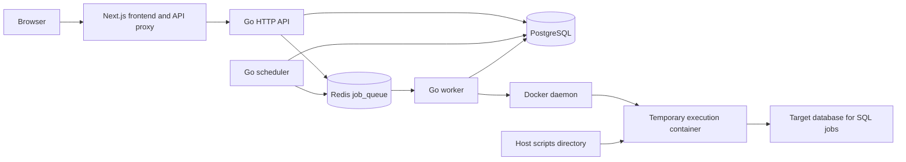

# Job Scheduler

An administrator workspace for creating script jobs, scheduling their execution, and inspecting results. The backend uses Go, PostgreSQL, Redis, and Docker. The Next.js frontend, branded Taskflow, provides login, job forms, schedule management, monitoring, run history, and live logs.

For frontend development and UI internals, see [frontend/README.md](frontend/README.md).

## Features and scope

| Feature         | Current behavior                                                                            |
| --------------- | ------------------------------------------------------------------------------------------- |
| Authentication  | Seeded administrator, bcrypt password hashes, 24-hour HS256 JWTs                            |
| Jobs            | Create and list jobs; inspect configuration; trigger enabled jobs manually                  |
| Script runtimes | Python, Node.js, Bash, and Go                                                               |
| SQL jobs        | PostgreSQL, MySQL, SQL Server, and Oracle connections; encrypted database passwords         |
| Scheduling      | One-time execution, intervals in seconds, five-field cron with IANA timezones               |
| Execution       | A temporary Docker container for each run, with resource limits and a timeout               |
| Monitoring      | Automatic executions grouped by job, next-run timing, status, duration, exit code, and logs |
| Logs            | Persisted stdout/stderr, cursor pagination, SSE, polling fallback, and frontend downloads   |
| Frontend        | Responsive admin workspace, GSAP transitions, keyboard dialogs, and reduced-motion support  |

There are no public registration, job update/delete, run cancellation, or retry endpoints. The API accepts the `custom` script type, but the worker has no executor for it; the frontend deliberately excludes it.

## Architecture and execution flow



1. The API stores a job's configuration in PostgreSQL. Creating a job does not execute it or create a schedule.
2. A manual trigger inserts a `queued` run and pushes its ID into Redis. Alternatively, the scheduler finds a due enabled schedule for an enabled job, inserts a run, advances the schedule, commits, and pushes the run ID.
3. A worker consumes the `job_queue` list using `BRPOP`. Producers use `LPUSH`, giving FIFO queue order.
4. The worker atomically changes a queued run to `running`, records its worker ID and start time, validates mounted paths, and starts a temporary container through the Docker SDK.
5. Output lines are written to PostgreSQL while the container runs. The worker then stores the terminal status, finish time, exit code, and any error.
6. The UI reads persisted state through the API. Live log delivery uses SSE, with polling if streaming fails.

Each worker processes one run at a time. Additional workers can consume the same queue. The scheduler uses `FOR UPDATE ... SKIP LOCKED` to claim up to 100 due schedules per processing pass.

## Repository structure

```text
api/                    HTTP routes, authentication, jobs, schedules, runs, logs
scheduler/              Due-schedule polling and next-run calculation
worker/                 Queue consumer, path validation, run state, log persistence
internal/dockerexec/    Docker container configuration and lifecycle
internal/sqljob/        AES-GCM credentials and database drivers/connections
sqlrunner/              Binary that executes SQL inside a run container
migrations/             PostgreSQL initialization and schema changes
scripts/                Files mounted read-only at /scripts
frontend/               Next.js admin application and browser tests
docs/                   Generated Swagger documentation
docker-compose.yml      PostgreSQL, Redis, API, worker, and scheduler services
```

The Go module targets Go 1.26.5. The Compose stack uses PostgreSQL 16 and Redis 7. The frontend currently declares Next.js 16.4.2, React 19.3.0, TypeScript, GSAP, Lucide icons, and Tailwind CSS tooling. Use the checked-in lockfiles for reproducible dependency installation.

## Local setup

### Requirements

- Docker Engine and Docker Compose, with permission to access the Docker daemon.
- Node.js >=20.9.0, as required by the installed Next.js package, and npm for the frontend.
- OpenSSL or another way to generate a base64-encoded 32-byte encryption key.
- Go 1.26.5 when running Go tools outside Docker.

The frontend is started separately; it is not a service in the current Compose file.

### Configure the backend

Create `.env` at the repository root. There is currently no checked-in `.env.example`.

```dotenv
POSTGRES_USER=app
POSTGRES_PASSWORD=replace-with-a-local-database-password
POSTGRES_DB=scheduler
SQL_CREDENTIALS_KEY=replace-with-base64-encoded-32-random-bytes
SCRIPTS_HOST_PATH=/absolute/path/to/job_scheduler/scripts

# Optional execution limits:
JOB_CONTAINER_MEMORY_BYTES=268435456
JOB_CONTAINER_NANO_CPUS=500000000
JOB_CONTAINER_PIDS_LIMIT=128
JOB_CONTAINER_NETWORK_DISABLED=true
```

Generate the encryption key once:

```bash
openssl rand -base64 32
```

Set `SCRIPTS_HOST_PATH` to the absolute `scripts` path on the **Docker daemon host**. The worker itself mounts `./scripts:/scripts:ro`, while the containers it creates bind the host path from `SCRIPTS_HOST_PATH`. These must refer to the same files. Remote Docker daemons require the files on the remote host.

**Admin configuration in the current Compose file:** `ADMIN_EMAIL`, `ADMIN_USERNAME`, `ADMIN_PASSWORD`, and `JWT_SECRET` are literal values in `services.api.environment`. Change those entries in `docker-compose.yml` before deployment, or replace them with `${VARIABLE:?Set VARIABLE in .env}` references and supply the variables in `.env`. Adding variables to `.env` alone does not override the existing literal values. The API port and Redis address are also explicitly set by Compose.

Login uses **email and password**. `ADMIN_USERNAME` is required when seeding the account, but it is not a login credential. Seeding uses `ON CONFLICT (email) DO NOTHING`: restarting with a different password for an existing email does not update that account's stored password.

### Start backend and frontend

From the repository root:

```bash
docker compose up -d --build
docker compose ps
```

In another terminal:

```bash
cd frontend
npm ci
npm run dev
```

Local addresses:

| Component            | Address                                    |
| -------------------- | ------------------------------------------ |
| Admin workspace      | `http://localhost:3000`                    |
| Go API               | `http://localhost:8080`                    |
| Swagger UI           | `http://localhost:8080/swagger/index.html` |
| PostgreSQL host port | `localhost:5432`                           |
| Redis host port      | `localhost:6379`                           |

The frontend defaults to the API at `http://127.0.0.1:8080`. Set `BACKEND_URL` in `frontend/.env.local` if necessary; this is a server-only variable. Restart Next.js after changing it.

### Database initialization and upgrades

Compose mounts both SQL migration files into PostgreSQL's initialization directory. They run automatically only when the PostgreSQL data directory is empty. Restarting an existing volume does not rerun migrations.

For an existing database that already has migration 001 but lacks SQL connection support, back it up and apply migration 002 explicitly:

```bash
docker compose exec -T postgres sh -c 'psql -v ON_ERROR_STOP=1 -U "$POSTGRES_USER" -d "$POSTGRES_DB"' < migrations/002_sql_job_connections.sql
```

Do not rerun migration 001 against an initialized database: its table creation statements are not idempotent. PostgreSQL data lives in the named `postgres_data` volume. Normal `docker compose down` retains it; `docker compose down -v` removes it and deletes stored data. The current Redis service has no configured persistent volume or explicit durable-queue setup.

## Creating jobs

Put the script in the repository's `scripts/` directory before creating a job. The frontend expects an absolute path such as `/scripts/hello.py`. The worker also supports relative paths resolved under `/scripts`, but rejects paths and symlinks that escape that directory. A script must be a regular file and the working directory must exist under `/scripts`.

| `script_type` | Executed command                                                      |
| ------------- | --------------------------------------------------------------------- |
| `python`      | `python3 /scripts/file.py ...args`                                    |
| `node`        | `node /scripts/file.js ...args`                                       |
| `bash`        | `bash /scripts/file.sh ...args`                                       |
| `go`          | `go run /scripts/file.go ...args`                                     |
| `sql`         | `/usr/local/bin/sqlrunner` with an encrypted connection configuration |

Arguments are separate argv entries, not a shell command string. To run shell syntax, put it in a Bash script. Extra runtime packages must be included in the execution image; the read-only filesystem and default network isolation prevent treating each run as an unrestricted installation environment. For Go scripts, arrange writable build/cache locations under `/tmp` when needed.

Example script-job request body:

```json
{
  "name": "Hello Python",
  "description": "Run the mounted example",
  "script_type": "python",
  "script_path": "/scripts/hello.py",
  "args": ["--verbose"],
  "env": { "APP_ENV": "development" },
  "working_dir": "/scripts",
  "timeout_seconds": 60,
  "enabled": true
}
```

Use arguments your actual script supports. `timeout_seconds` defaults to 300 when omitted or zero and must otherwise be positive. `args` defaults to `[]`, `env` to `{}`, and `enabled` to true. Although the API stores `script_content`, the worker executes the mounted file; it does not materialize that content into a script.

### SQL jobs

Use a `.sql` file and provide `connection` when `script_type` is `sql`:

```json
{
  "name": "Reporting maintenance",
  "script_type": "sql",
  "script_path": "/scripts/maintenance.sql",
  "timeout_seconds": 300,
  "enabled": true,
  "connection": {
    "engine": "sqlserver",
    "host": "database.example.internal",
    "port": 1433,
    "database": "reports",
    "username": "report_user",
    "password": "replace-with-database-password",
    "tls_enabled": true,
    "trust_server_certificate": false
  }
}
```

| Engine      | Default port | `database` meaning |
| ----------- | ------------ | ------------------ |
| `postgres`  | 5432         | Database name      |
| `mysql`     | 3306         | Database name      |
| `sqlserver` | 1433         | Database name      |
| `oracle`    | 1521         | Service name       |

A zero/omitted port selects the engine default. TLS defaults to enabled in the API when omitted. SQL Server also supports `trust_server_certificate`; keep certificate verification enabled for trusted deployments.

The API encrypts the password with AES-256-GCM before storing the connection JSON. Responses expose connection metadata and `password_configured`, not the password. The API and worker must share the same stable `SQL_CREDENTIALS_KEY`; losing or changing it without migrating stored credentials makes existing passwords unreadable.

SQL containers use Docker's default network so they can reach the target database. `localhost` refers to the execution container, not the Docker host or the Compose database. Supply a host reachable from that network; Compose service names are not automatically available on the default bridge.

The SQL runner reads the whole file and calls `ExecContext` once. It reports completion/rows affected rather than rendering SELECT result tables. It is not a database CLI: directives such as SQL Server `GO`, Oracle SQL*Plus commands, and engine-specific multi-statement behavior are subject to driver limitations. It does not add a transaction around the file. Job arguments, custom environment, and working directory do not configure SQL execution; the frontend hides those fields for SQL jobs.

## Scheduling semantics

Create a job first, then add schedules in **Schedules**. Both the **job** and **schedule** must be enabled. Enabling a schedule makes it eligible for automatic dispatch; it does not immediately start its script.

| Type       | Request fields                          | First and subsequent execution                                                                         |
| ---------- | --------------------------------------- | ------------------------------------------------------------------------------------------------------ |
| `once`     | `run_at` as an RFC3339 timestamp        | Due at that instant; schedule becomes disabled with no next run when dispatched                        |
| `interval` | Positive `interval_seconds`             | First due after the interval from creation/update; later due times are dispatch time plus the interval |
| `cron`     | Five-field `cron_expr`, IANA `timezone` | Next matching local time, stored as a UTC instant; recalculated after dispatch                         |

Request examples:

```json
{
  "type": "interval",
  "interval_seconds": 300,
  "timezone": "UTC",
  "enabled": true
}
```

```json
{
  "type": "cron",
  "cron_expr": "0 9 * * 1-5",
  "timezone": "Asia/Tehran",
  "enabled": true
}
```

```json
{
  "type": "once",
  "run_at": "2030-01-15T09:00:00Z",
  "timezone": "UTC",
  "enabled": true
}
```

Replace the example one-time date with your intended future time. Cron fields are minute, hour, day of month, month, and day of week; seconds and `@every` descriptors are not supported by this parser. The frontend converts the one-time browser-local datetime to a UTC timestamp; the timezone field controls cron interpretation.

Timing details:

- The scheduler processes due schedules at startup and every five seconds. Dispatch can therefore lag the due time, and execution can wait longer in the worker queue.
- Intervals are measured from dispatch, not from completion of the prior run. There is no per-job overlap lock across workers.
- A delayed schedule produces one run when processed, then calculates its next future time. Missed intervals/cron occurrences are not replayed individually.
- `PATCH /api/schedules/{id}` expects the complete schedule configuration, including `type` and its timing fields. It is not a merge-patch. Updating, pausing, or enabling recalculates `next_run_at`.
- Pausing/deleting a schedule affects future dispatches. Already queued/running executions remain.
- **Run now** in the frontend calls the manual-run endpoint and opens logs. It adds an execution without changing the next automatic time, even if the schedule itself is paused; the job must still be enabled.
- A one-time schedule becoming inactive proves dispatch, not successful completion. Inspect the run result.

## Confirming execution

1. Open **Schedules** to check enabled state and `next_run_at`.
2. Open **Monitoring** for automatic runs only. Inspect the latest result, active execution, duration, exit code, and next-run countdown.
3. Open **Run history** for both manual and automatic executions.
4. Open a run's **Live logs** to inspect stdout/stderr and errors. A completed script normally has status `success` and exit code `0`.

Run statuses are `queued`, `running`, `success`, `failed`, `timeout`, and `canceled`. `queued` means a run record exists, not that a worker has started it. `canceled` is an internal terminal status; there is no user-facing cancellation API.

Monitoring groups by job because runs contain `job_id` and `trigger_type`, but no `schedule_id`. It cannot attribute an execution to a particular schedule when a job has several. Workspace data refreshes approximately every 15 seconds after each load; countdowns update locally every second. Dashboard statistics cover the loaded history, limited to the latest 500 runs per job.

## HTTP API reference

All `/api/*` routes except login require `Authorization: Bearer <token>`. Health, readiness, and Swagger are public on the Go server. Successful API objects use JSON; errors are generally plain text.

| Method | Route                        | Purpose / response                                  |
| ------ | ---------------------------- | --------------------------------------------------- |
| GET    | `/health`                    | HTTP availability; `200` plain text                 |
| GET    | `/ready`                     | PostgreSQL ping; `200` or `503`                     |
| POST   | `/api/auth/login`            | `{email,password}` → `200 {token}`                  |
| GET    | `/api/auth/me`               | `200 {id,email,role}`                               |
| GET    | `/api/jobs`                  | Job list                                            |
| POST   | `/api/jobs`                  | Create job; `201` job object                        |
| GET    | `/api/jobs/{id}/runs`        | Latest 500 runs for a job                           |
| POST   | `/api/jobs/{id}/run`         | Queue enabled job; `202` run object                 |
| GET    | `/api/jobs/{id}/schedules`   | List job schedules                                  |
| POST   | `/api/jobs/{id}/schedules`   | Create schedule; `201` schedule object              |
| PATCH  | `/api/schedules/{id}`        | Replace timing/configuration; `200` schedule object |
| DELETE | `/api/schedules/{id}`        | Delete schedule; `204`                              |
| GET    | `/api/runs/{id}`             | Run status and metadata                             |
| GET    | `/api/runs/{id}/logs`        | Log entries after a cursor                          |
| GET    | `/api/runs/{id}/logs/stream` | SSE log stream and terminal `done` event            |
| GET    | `/swagger/*`                 | Generated Swagger UI and specification              |

For direct API use:

```bash
curl -X POST http://localhost:8080/api/auth/login \
  -H 'Content-Type: application/json' \
  -d '{"email":"your-admin-email","password":"your-admin-password"}'

TOKEN='paste-returned-token'
JOB_ID='paste-job-uuid'

curl http://localhost:8080/api/jobs -H "Authorization: Bearer $TOKEN"
curl -X POST "http://localhost:8080/api/jobs/$JOB_ID/run" \
  -H "Authorization: Bearer $TOKEN"
```

Use the job JSON above as the body of `POST /api/jobs`. Keep tokens out of shared logs and source control.

Log queries accept `after` (nonnegative log ID, default 0) and `limit` (1–1000, default 200). Results are ascending by ID, with `id`, `run_id`, `timestamp`, `stream`, and `message`. Continue requesting after the last received ID until a page is shorter than the limit.

```bash
RUN_ID='paste-run-uuid'
curl "http://localhost:8080/api/runs/$RUN_ID/logs?after=0&limit=1000" \
  -H "Authorization: Bearer $TOKEN"
curl -N "http://localhost:8080/api/runs/$RUN_ID/logs/stream?after=0&limit=1000" \
  -H "Authorization: Bearer $TOKEN"
```

SSE emits log entries as default message events with an `id`, then a `done` event with the terminal status. The endpoint polls PostgreSQL every second. For completed runs it may emit `done` after one page, so clients needing complete historical output must paginate the logs endpoint; the frontend handles this before streaming and drains remaining output after completion. The server uses the `after` query cursor; it does not implement `Last-Event-ID` recovery.

Regenerate Swagger after endpoint/model changes:

```bash
go run github.com/swaggo/swag/cmd/swag@v1.16.6 init -g api/main.go -o docs --parseDependency --parseInternal
```

Generated documentation is separate from runtime route registration in `api/main.go`.

## Storage, isolation, and operational limits

PostgreSQL tables are `users`, `jobs`, `schedules`, `runs`, and `run_logs`. IDs are UUIDs except the monotonically increasing log ID. Configuration fields such as arguments, environment, and SQL connection data use JSONB; execution times use `TIMESTAMPTZ`. Indexes support due schedules, recent job runs, and cursor log reads. No automatic history/log retention policy is implemented.

Execution containers use a read-only root filesystem and `/scripts` bind mount, a 64 MiB writable `/tmp`, dropped Linux capabilities, `no-new-privileges`, and configurable memory/CPU/PID limits. Defaults are 256 MiB memory, 0.5 CPU, and 128 PIDs. Normal script networking is disabled by default; SQL networking is enabled independently. Containers are labeled with the run ID and removed after execution.

This is a trusted-administrator system. The worker's Docker socket grants powerful host access, and regular script jobs inherit the worker environment before job-specific overrides, potentially including service credentials. Isolation limits do not make it suitable for untrusted script submissions. Use HTTPS for the frontend, protect exposed database/Redis ports, replace development secrets, and preserve the encryption key with backups.

The queue has no acknowledgement/requeue protocol, retry policy, dead-letter queue, or stale-run recovery. Database commits and Redis pushes are separate operations: a crash between them can leave a queued run undispatched. A worker crash after `BRPOP` can lose the queue item and leave an unfinished record. Redis push errors are recorded as failed when possible, but there is no automatic retry. Treat this as a functional scheduler with these reliability limits, rather than an exactly-once execution system.

## Troubleshooting and service commands

```bash
docker compose ps
docker compose logs --tail=100 api scheduler worker
curl http://localhost:8080/health
curl http://localhost:8080/ready
```

| Symptom                              | What to inspect                                                                                     |
| ------------------------------------ | --------------------------------------------------------------------------------------------------- |
| Login fails                          | Effective Compose admin email; stored account password; API logs; email rather than username        |
| Session fails after database reset   | Sign in again; middleware rejects JWTs whose admin record no longer exists                          |
| Could not create job                 | API and PostgreSQL logs; schema migrations; valid session; required fields/SQL connection           |
| Enabled schedule never runs          | Enabled job and schedule; due time; scheduler logs; scheduler/Redis/worker availability             |
| Run remains queued                   | Worker logs, Redis queue, Docker socket, and the queue recovery limits above                        |
| Run fails before output              | Script/working directory existence, matching host mount paths, supported runtime                    |
| Script cannot write/install packages | Read-only paths; use `/tmp` or prepare dependencies in the image                                    |
| SQL connection/decryption fails      | Reachable database host/port, TLS settings, permissions, and unchanged shared encryption key        |
| Logs appear late                     | Script output buffering; flush output or use unbuffered runtime settings, e.g. `PYTHONUNBUFFERED=1` |
| UI cannot reach API                  | Server-side `BACKEND_URL`, backend health, and restart Next.js after environment changes            |
| Health is green but work is stuck    | `/ready` checks PostgreSQL only; neither health route verifies scheduler/worker/Redis processing    |

Rebuild backend services after Go changes:

```bash
docker compose up -d --build api scheduler worker
```

For a frontend production build, run `npm run build` and `npm start` inside `frontend/`. Serve it through HTTPS: production session cookies are Secure. The current Google font setup needs build-time network access. The repository does not include a frontend Dockerfile or an automated deployment pipeline.

## Development checks

From the repository root:

```bash
go test ./...
go vet ./...
docker compose config --quiet
```

From `frontend/`:

```bash
npm run lint
npx tsc --noEmit
npm run build
npx playwright install chromium
npm run test:e2e
```

Go tests cover authentication session validation and scheduler processing, including reading/closing the due rows before writing on the same transaction connection. Browser tests use a fixture API and an isolated Next.js server to exercise UI/proxy workflows; they do not prove real Docker execution or connectivity to all supported SQL databases. See the frontend README for test ports, browser dependencies, and manual end-to-end checks.
